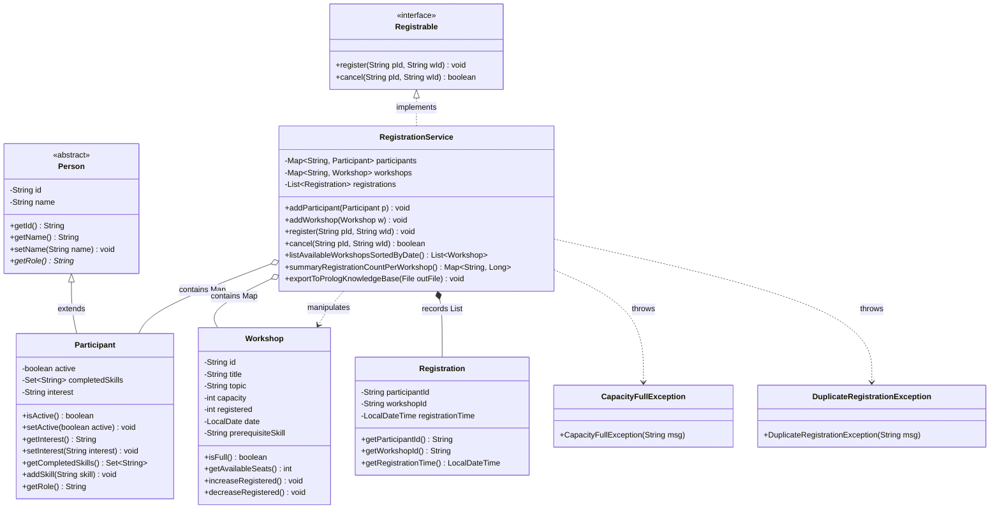

# Workshop Registration & Suggester 🎓💡

[](https://www.oracle.com/java/)
[](https://www.swi-prolog.org/)
[](LICENSE)

> **Tugas Besar Pemrograman Lanjut — S1 Teknik Informatika (Offering TI-A)**  
> **Kelompok 5 — Pertemuan 12 s.d 15 (Project Design, Implementation, & Reasoning)**

---

## 👥 Identitas Tim Pengembang (Kelompok 5)

| No | Nama Lengkap | NIM | Peran Utama |
|:---:|:---|:---:|:---|
| 1 | **Aditya Widyatamaka Tri Utomo** | 250535623587 | Core Logic & Stream Processing |
| 2 | **Chasbiah Azzahra** | 250535621731 | Data Modeling & Collections |
| 3 | **Dzauq Bachrul ‘Ulum** | 250535621835 | Exception Handling & Prolog KB |
| 4 | **Elshifa Viorissa** | 250535621859 | Testing, Validation & Documentation |

---

## 📌 Ringkasan Masalah & Solusi (Problem Discovery)

### 1. Masalah Utama
* Pendaftaran workshop kampus selama ini masih dicatat secara manual (spreadsheet), menyebabkan:
  * Kapasitas ruangan sering terlampaui (*overcapacity*).
  * Terjadi pendaftaran ganda (*duplicate registration*).
  * Peserta kesulitan mengetahui workshop yang sesuai dengan keahlian (*skill*) dan minat mereka.
  * Panitia harus memverifikasi prasyarat kompetensi peserta satu per satu secara manual.

### 2. Solusi Gabungan Java + Prolog
* **Java (Data Management & Business Process):**
  Mengelola data peserta, workshop, dan transaksi pendaftaran di memori menggunakan prinsip OOP (Encapsulation, Inheritance, Polymorphism, Abstraction, Interface), Collections/Generics, Stream API/Lambda, serta Custom Exception Handling.
* **Prolog (Rule-Based Reasoning & Logic Engine):**
  Menalar kelayakan peserta (*eligibility*), memberikan rekomendasi workshop multi-kondisi, menelusuri rantai prasyarat skill berantai secara rekursif (*prerequisite chain*), dan memanfaatkan *backtracking* untuk menyajikan multi-solusi alternatif.

---

## 🏛️ Arsitektur & UML Class Diagram



---

## ⚙️ Detail Spesifikasi Modul

### ☕ 1. Modul Java (OOP & Stream API)
| Konsep / Komponen | Implementasi di Kode | Tujuan & Manfaat Desain |
|:---|:---|:---|
| **Encapsulation** | `Workshop.capacity` & `registered` berstatus `private` | Perubahan kuota pendaftar hanya bisa melalui `increaseRegistered()` yang memvalidasi kapasitas maksimum. |
| **Inheritance & Overriding** | `Participant extends Person` meng-override `getRole()` | Mencegah penulisan ulang atribut identitas (`id`, `name`), peran khusus didefinisikan pada subclass. |
| **Polymorphism** | `List<Person>` memanggil method `getRole()` | Objek dapat diperlakukan sebagai induk (`Person`) namun mengeksekusi perilaku polimorfis tanpa `if-else`. |
| **Abstract Class** | `Person` | Mencegah instansiasi objek "orang" tanpa peran yang jelas di sistem. |
| **Interface** | `Registrable` diimplementasikan oleh `RegistrationService` | Memisahkan kontrak transaksi pendaftaran dari detail implementasinya, memudahkan pengujian unit. |
| **Collections / Generics** | `Map<String, Participant>`, `Map<String, Workshop>`, `List<Registration>`, `Set<String>` | Akses $O(1)$ berdasarkan ID, urutan transaksi terjaga pada `List`, dan `Set` mencegah duplikasi skill. |
| **Stream API 1** | `workshops.values().stream().filter(w -> !w.isFull()).sorted(Comparator.comparing(Workshop::getDate)).toList()` | Menyaring workshop yang masih membuka pendaftaran dan mengurutkannya dari tanggal terdekat. |
| **Stream API 2** | `registrations.stream().collect(Collectors.groupingBy(Registration::getWorkshopId, Collectors.counting()))` | Merekapitulasi jumlah pendaftar per workshop secara deklaratif dan ringkas untuk laporan panitia. |
| **Custom Exceptions** | `CapacityFullException` & `DuplicateRegistrationException` | Menegakkan *Business Rule* kapasitas maksimum dan pencegahan pendaftaran ganda dengan pesan error spesifik. |

---

### 🧠 2. Modul Prolog (Knowledge Base & Reasoning)

#### A. Fakta (Facts)
* `active/1`: Menandai mahasiswa aktif yang berhak mengikuti kegiatan.
* `completed/2`: Keahlian/skill yang telah dikuasai mahasiswa (`basic_java`, `oop`, `basic_prolog`).
* `interest/2`: Minat spesifik peserta (`backend`, `ai`).
* `topic/2`: Topik pembahasan workshop (`backend`, `ai`).
* `requires/2`: Prasyarat skill langsung suatu workshop.
* `seats_available/1`: Status ketersediaan kursi workshop (hanya ada jika kuota belum penuh).
* `prerequisite/2`: Graf berarah prasyarat antar-keahlian (`prerequisite(advanced_java, oop)`).

#### B. Aturan (Rules)
* **R1 — `eligible/2`**:
  ```prolog
  eligible(P, W) :- active(P), requires(W, S), completed(P, S).
  ```
* **R2 — `recommended/2` (Multi-Kondisi)**:
  ```prolog
  recommended(P, W) :- 
      eligible(P, W), 
      interest(P, T), 
      topic(W, T), 
      seats_available(W).
  ```
* **R3 — `prereq_of/2` (Rekursif & Base Case)**:
  ```prolog
  prereq_of(X, Y) :- prerequisite(X, Y).
  prereq_of(X, Z) :- prerequisite(X, Y), prereq_of(Y, Z).
  ```
* **R4 — `missing_skill/3` (Deteksi Kekurangan Prasyarat)**:
  ```prolog
  missing_skill(P, W, S) :- requires(W, S), \+ completed(P, S).
  ```

---

## 🧪 Rencana Pengujian (Test Cases)

### A. Pengujian Java (5 Unit Tests Otomatis)
File: `src/test/RegistrationTest.java`
1. **Test 1 — Pendaftaran Normal:** Memastikan pendaftaran peserta aktif pada workshop berkuota berhasil dan mengurangi sisa kursi.
2. **Test 2 — CapacityFullException:** Memastikan sistem melempar `CapacityFullException` saat pendaftaran melebihi kuota.
3. **Test 3 — DuplicateRegistrationException:** Memastikan sistem melempar `DuplicateRegistrationException` saat peserta mendaftar ulang pada workshop yang sama.
4. **Test 4 — Stream Filter & Sort:** Menguji penyaringan workshop yang masih ada kursi dan pengurutan tanggal dari yang terdekat.
5. **Test 5 — Stream GroupingBy:** Menguji rekapitulasi jumlah pendaftar per workshop secara akurat.

### B. Pengujian Prolog (5 Query Skenario)
File: `prolog/queries.pl`
| ID | Query Prolog | Hasil Diharapkan | Penjelasan Logika |
|:---:|:---|:---:|:---|
| **Q1** | `eligible(p001, w01).` | `true` | Peserta aktif & telah menyelesaikan prasyarat `basic_java`. |
| **Q2** | `recommended(p003, w03).` | `false` *(gagal)* | Walaupun minat cocok, `seats_available(w03)` tidak ada (kursi penuh). |
| **Q3** | `recommended(p002, W).` | `W = w01` | Hanya `w01` yang memenuhi prasyarat `p002` (`basic_java`). |
| **Q4** | `recommended(p001, W).` | `W = w01 ; W = w02` | **Backtracking multi-solusi:** menemukan seluruh workshop yang cocok. |
| **Q5** | `prereq_of(design_pattern, X).` | `X = advanced_java ; oop ; basic_java` | **Rekursi:** menelusuri rantai prasyarat berantai sampai ke *base case*. |

---

## 🔄 Sinkronisasi Java & Prolog (Stage 5)
Data runtime pada aplikasi Java dapat langsung disinkronkan ke format pengetahuan Prolog melalui menu **7 (Ekspor Data ke Prolog Knowledge Base)** pada aplikasi Java.
* ID Java `P001` secara otomatis dikonversi menjadi atom Prolog `p001`.
* Method `exportToPrologKnowledgeBase()` meng-generate fakta terikini (`active/1`, `completed/2`, `seats_available/1`, dll.) ke dalam file `prolog/exported_data.pl`.

---

## 🚀 Panduan Menjalankan Aplikasi

### 1. Prasyarat Sistem
* **Java Development Kit (JDK) 17+**
* **SWI-Prolog**

### 2. Menjalankan Modul Java
Buka terminal pada direktori *root* repositori:

```bash
# Kompilasi seluruh source code Java
javac -d bin -sourcepath src src/Main.java src/test/RegistrationTest.java

# Menjalankan Unit Tests Mandiri (5 Test Otomatis)
java -cp bin test.RegistrationTest

# Menjalankan Aplikasi CLI Interaktif
java -cp bin Main
```

### 3. Menjalankan Modul SWI-Prolog
```bash
# Masuk ke direktori prolog
cd prolog

# Buka knowledge base di SWI-Prolog
swipl knowledge_base.pl

# Jalankan query di dalam konsol Prolog:
?- [queries].
?- eligible(p001, w01).
?- recommended(p001, W).
?- prereq_of(design_pattern, X).
?- halt.
```

---

## 📂 Struktur Direktori Repositori
```text
workshop-registration-suggester/
├── .gitignore
├── README.md                          # Dokumentasi Lengkap Proyek
├── docs/
│   └── LKM_12_Rancangan_Proyek.md     # Salinan Lengkap Desain LKM Pertemuan 12
├── java/                              # Referensi build Java
├── src/                               # Source Code Java (JDK 17+)
│   ├── Main.java                      # Interactive CLI Entry Point
│   ├── exception/
│   │   ├── CapacityFullException.java
│   │   └── DuplicateRegistrationException.java
│   ├── model/
│   │   ├── Person.java                # Abstract Class
│   │   ├── Participant.java           # Subclass (Inheritance & Polymorphism)
│   │   ├── Workshop.java              # Encapsulated Entity
│   │   └── Registration.java          # Association Entity
│   ├── service/
│   │   ├── Registrable.java           # Interface
│   │   └── RegistrationService.java   # Business Logic & Stream API
│   └── test/
│       └── RegistrationTest.java      # 5 Standalone Unit Tests
└── prolog/                            # Modul Penalaran SWI-Prolog
    ├── knowledge_base.pl              # Facts & Rules (eligible, recommended, prereq_of)
    └── queries.pl                     # 5 Predefined Verification Queries
```
